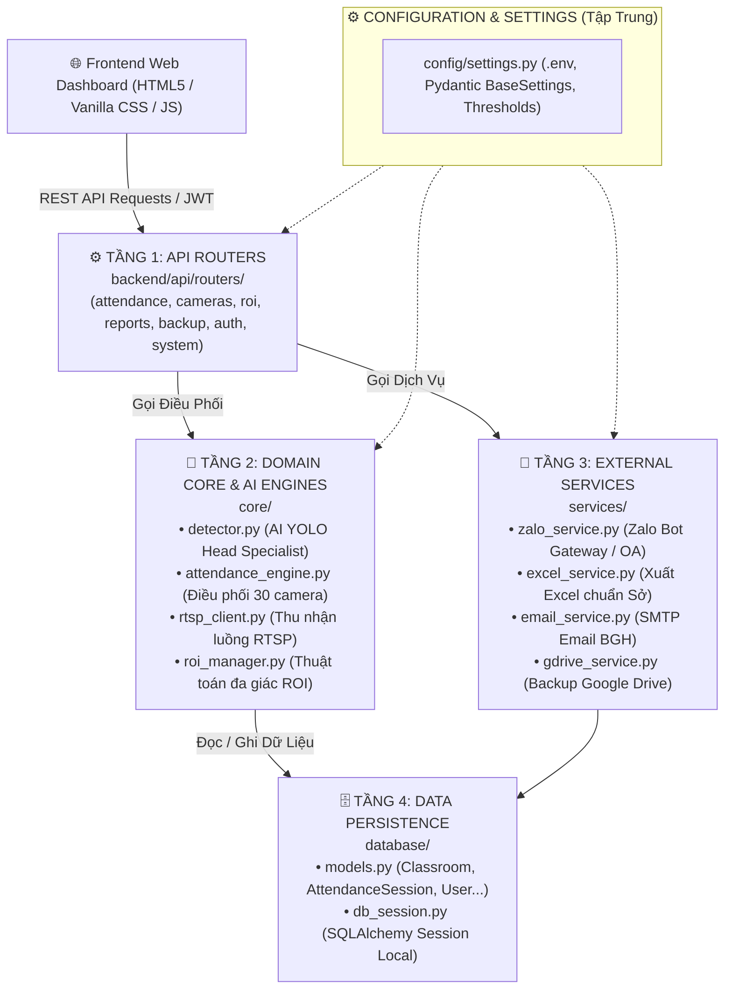

# 🎓 HỆ THỐNG ĐIỂM DANH HỌC SINH TỰ ĐỘNG BẰNG AI CAMERA
### Trường THPT Điều Cải


-brightgreen)


Hệ thống điểm danh tự động thông minh phục vụ **30 phòng học** (**1.246 học sinh**) tại **Trường THPT Điều Cải**, tích hợp thị giác máy tính AI chuyên biệt nhận diện đầu học sinh (`student_head`), thuật toán phân vùng không gian đa giác ROI (**Green Zone** - khu vực bàn học tính sĩ số / **Red Zone** - khu vực bục giảng loại trừ giáo viên), kiến trúc phân tầng độc lập (**Clean Layered Architecture**), hệ thống bảo mật **JWT + Bcrypt**, lập lịch tự động lúc **06:45 AM**, xuất báo cáo Excel chuẩn Sở GD&ĐT và thông báo Zalo tức thời.

---

## 🌟 TÍNH NĂNG NỔI BẬT

1. **AI Đếm Sĩ Số Lớp Học Chuyên Biệt (`student_head` Specialist):**
   - Huấn luyện trực tiếp trên tập dữ liệu ảnh camera thực tế của trường THPT Điều Cải ([`dataset/studenthead1.v1-1.yolo26`](dataset/studenthead1.v1-1.yolo26)), giải quyết triệt để vấn đề xung đột nhãn giữa người toàn thân (COCO) và đầu học sinh.
   - Nhận diện cực kỳ sắc nét học sinh ở các dãy bàn xa góc camera và học sinh cúi gằm mặt đọc/viết bài.
   - Thuật toán khử trùng lặp đa mô hình (NMS + Anatomical IoS) tối ưu: không bao giờ gộp nhầm 2 học sinh ngồi trước-sau trên cùng một hàng dọc.

2. **Phân Vùng Không Gian Đa Giác Độc Lập (Spatial ROI Masking):**
   - **Green Zone (Khu vực bàn học sinh - Phần LẤY):** AI chỉ đếm và đánh số thứ tự `#01, #02, #03...` cho người nằm trong ranh giới bàn học sinh (dung sai mép viền thích ứng 25px).
   - **Red Zone (Khu vực bục giảng - Phần BỎ ĐI):** Tự động loại trừ 100% giáo viên đứng hoặc ngồi tại bục giảng/bàn giáo viên, không tính nhầm vào sĩ số học sinh.
   - Công cụ vẽ Canvas trực quan trên Web, hỗ trợ kéo thả đỉnh đa giác và lưu tọa độ riêng biệt cho từng phòng học.

3. **Kiến Trúc Backend Phân Tầng Dễ Bảo Trì (Clean Layered Architecture):**
   - Phân tách rõ ràng 4 tầng: **Routers API** $\rightarrow$ **Core AI/Hardware** $\rightarrow$ **Services (Zalo/Email/Excel)** $\rightarrow$ **Database ORM**.
   - Thiết kế khớp nối lỏng (Loose Coupling): khi nâng cấp AI Detector, đổi giao thức camera hay đổi tài khoản Zalo, các tầng khác **hoàn toàn không bị ảnh hưởng**.

4. **Quản Lý Camera Toàn Diện & Live Snapshot:**
   - Hỗ trợ đa dạng nguồn cấp: Camera IP RTSP (Dahua NVR, Hikvision, Uniview), Webcam máy tính, File video/ảnh mô phỏng.
   - Tự động kích hoạt tín hiệu đèn hồng ngoại camera báo hiệu 3 giây trước giờ chụp ảnh.
   - Kiểm tra kết nối TCP nhanh và xem trước ảnh trực tiếp (*Live Snapshot*) tức thì trước khi lưu cấu hình.

5. **Trình Soi Chi Tiết AI Tracking (Interactive Lightbox Zoom & Pan):**
   - Bấm vào ảnh lớp học để mở trình xem ảnh toàn màn hình với hiệu ứng kính mờ (*Glassmorphism*).
   - Hỗ trợ cuộn chuột zoom từ 60% đến 500%, kéo chuột rê ảnh (*Pan*) để soi rõ từng vị trí học sinh kèm huy hiệu số thứ tự neon tương phản cao.

6. **Tự Động Hóa Vận Hành & Báo Cáo Thông Minh:**
   - Lập lịch tự động quét lúc **06:45 AM** hàng ngày (Thứ 2 đến Thứ 7) qua **APScheduler**.
   - Tự động xuất file báo cáo **Excel (.xlsx)** định dạng chuẩn của Sở GD&ĐT.
   - Gửi tin nhắn tóm tắt sĩ số tức thời qua **Zalo Bot Gateway** hoặc Zalo Official Account.
   - Sao lưu dữ liệu đám mây **Google Drive** tự động theo ngày.

---

## 🏛️ KIẾN TRÚC HỆ THỐNG & CẤU TRÚC THƯ MỤC

### 1. Sơ Đồ Kiến Trúc 4 Tầng Backend (Clean Architecture)



### 2. Cấu Trúc Thư Mục Chuẩn Hóa

```text
hethongdiemdanh Dieu Cai/
│
├── 🎨 frontend/                     # [GIAO DIỆN NGƯỜI DÙNG] Web Dashboard Glassmorphism
│   ├── index.html                  # Dashboard giám sát điểm danh thời gian thực 30 lớp
│   ├── login.html                  # Trang đăng nhập (JWT + HTTP-only cookie)
│   ├── cameras.html                # Quản lý danh sách & kiểm tra kết nối Camera/Webcam
│   ├── roi-config.html             # Công cụ vẽ phân vùng đa giác ROI (HTML5 Canvas)
│   ├── reports.html                # Bảng tra cứu lịch sử & xuất báo cáo Excel, gửi Zalo
│   ├── notifications.html          # Cấu hình kênh thông báo Zalo & SMTP Email
│   ├── css/                        # Hệ thống CSS Glassmorphism & Responsive layout
│   └── js/                         # API Client trung tâm (api.js) và logic các màn hình
│
├── ⚙️ backend/                      # [MÁY CHỦ REST API] FastAPI Framework
│   ├── main.py                     # Khởi động FastAPI, CORS, Middleware, Lifespan
│   ├── api/
│   │   ├── deps.py                 # Dependency Injection: Cung cấp DB Session, Auth Current User
│   │   ├── security.py             # Bảo mật: JWT Token, băm mật khẩu bcrypt
│   │   └── routers/                # Bộ định tuyến RESTful API phân theo chức năng:
│   │       ├── attendance.py       # /api/attendance: Quét điểm danh & phiên làm việc
│   │       ├── cameras.py          # /api/cameras: Quản lý Camera, snapshot live test
│   │       ├── roi.py              # /api/roi: Tọa độ ROI đa giác, test nhận diện tức thì
│   │       ├── reports.py          # /api/reports: Lịch sử điểm danh, xuất báo cáo Excel
│   │       ├── backup.py           # /api/backup: Sao lưu CSDL local & Google Drive
│   │       ├── auth.py             # /api/auth: Đăng nhập, quên mật khẩu, phân quyền
│   │       └── system.py           # /api/system: Giám sát tài nguyên CPU, GPU RTX, RAM
│   └── schemas/                    # Pydantic Schemas xác thực dữ liệu đầu vào/ra
│
├── 🧱 core/                         # [CỐT LÕI HỆ THỐNG] Động cơ AI & Giao tiếp thiết bị
│   ├── detector.py                 # AI YOLO nhận diện đầu học sinh + NMS + Anatomical IoS
│   ├── attendance_engine.py        # Điều phối quét điểm danh đồng loạt 30 lớp học
│   ├── rtsp_client.py              # Thu nhận luồng hình ảnh đa luồng (RTSP/Webcam/File)
│   ├── roi_manager.py              # Thuật toán Point-in-Polygon lọc khu vực Green / Red Zone
│   ├── relay_service.py            # Giao thức điều khiển tín hiệu đèn camera
│   └── image_enhancer.py           # Bộ cân bằng sáng thích ứng cục bộ CLAHE
│
├── 🔌 services/                     # [DỊCH VỤ TÍCH HỢP NGOẠI VI]
│   ├── zalo_service.py             # Tích hợp gửi tin nhắn Zalo Bot Gateway / OA
│   ├── email_service.py            # Tích hợp SMTP gửi báo cáo Ban Giám Hiệu
│   ├── excel_service.py            # Xuất file báo cáo Excel chuẩn mẫu GD&ĐT
│   └── gdrive_service.py           # Tích hợp OAuth 2.0 sao lưu đám mây
│
├── 🗄️ database/                     # [CƠ SỞ DỮ LIỆU] SQLAlchemy ORM & SQLite
│   ├── models.py                   # ORM Models (Classroom, AttendanceSession, User,...)
│   ├── db_session.py               # Quản lý kết nối Session & Seed admin khởi tạo
│   └── attendance.db               # Tệp tin CSDL SQLite chính thức
│
├── 📁 dataset/                      # [KHO DỮ LIỆU MÁY HỌC THỰC TẾ]
│   ├── classroom.yaml              # Cấu hình dataset YOLO chuẩn cho THPT Điều Cải
│   ├── studenthead_real.yaml       # Cấu hình bộ dữ liệu camera thực tế
│   └── studenthead1.v1-1.yolo26/   # Bộ dữ liệu 182 ảnh camera thực tế (train/valid)
│
├── 📦 models/                       # [TRỌNG SỐ MÔ HÌNH AI]
│   ├── classroom_best.pt           # Model chuyên biệt nhận diện đầu học sinh THPT Điều Cải
│   └── yolo26m.pt                  # Trọng số nền tảng Ultralytics
│
├── ⚙️ config/                       # Cấu hình tập trung (settings.py, logging_config.py)
├── 🧪 tests/                        # Bộ kiểm thử tự động Pytest (47/47 test cases PASSED)
│
├── 🚀 TỆP TIN THỰC THI CHÍNH:
│   ├── run.bat                     # 1-click khởi động toàn diện hệ thống trên Windows
│   ├── train_real_camera.bat       # 1-click huấn luyện AI trên GPU NVIDIA RTX 3050
│   ├── requirements.txt            # Danh sách thư viện phụ thuộc Python
│   └── .gitignore                  # Cấu hình loại trừ Git chuẩn (chặn video lớn, file nhạy cảm)
```

---

## 🚀 HƯỚNG DẪN CÀI ĐẶT VÀ CHẠY THỬ NGHIỆM LOCAL

### 1. Yêu Cầu Phần Cứng & Môi Trường
- **Hệ điều hành:** Windows 10 / 11 (hoặc Linux Ubuntu 22.04+).
- **Python:** Python 3.10 hoặc Python 3.11 (khuyến nghị).
- **GPU (tùy chọn):** NVIDIA GeForce RTX 3050 hoặc tương đương hỗ trợ CUDA 12.x giúp tăng tốc độ quét 30 camera lên gấp 5 lần.

### 2. Cài Đặt Thư Viện
Mở PowerShell tại thư mục dự án và chạy:
```powershell
pip install -r requirements.txt
```
*(Nếu máy tính có GPU NVIDIA, cài đặt PyTorch hỗ trợ CUDA: `pip install torch torchvision --index-url https://download.pytorch.org/whl/cu121`).*

### 3. Thiết Lập Biến Môi Trường (`.env`)
Tạo tệp `.env` từ `.env.example` hoặc chỉnh sửa trực tiếp các thông số kết nối:
```env
# Mật khẩu quản trị hệ thống
ADMIN_EMAIL=admin@truongdieucai.edu.vn
ADMIN_PASSWORD=Admin@2025

# Cấu hình đầu ghi camera trường học (Dahua / Hikvision)
DVR_HOST=192.168.10.200
DVR_PORT=554
DVR_USER=admin
DVR_PASSWORD=mat_khau_camera_cua_truong

# Khóa bảo mật JWT
JWT_SECRET=chuoi-ngau-nhien-bao-mat-dai-hon-32-ky-tu
```

### 4. Khởi Chạy 1-Click
Nhấp đúp chuột vào file:
```cmd
.\run.bat
```
Hệ thống sẽ tự động:
1. Phát hiện GPU CUDA (nếu có `venv_cuda`).
2. Tự động kiểm tra và khởi tạo CSDL SQLite với đầy đủ 30 phòng học chuẩn.
3. Bật máy chủ Web FastAPI tại địa chỉ: `http://localhost:8000`.

### 5. Khởi Chạy Bằng Docker & Docker Compose (Container Deployment)
Đóng gói hoàn chỉnh độc lập 2 container Frontend (Nginx) và Backend (FastAPI Python):
- **Windows 1-Click:** Nhấp đúp vào [scripts/docker_start.bat](scripts/docker_start.bat) (dừng bằng [scripts/docker_stop.bat](scripts/docker_stop.bat)).
- **Lệnh dòng lệnh:**
  ```bash
  docker compose up -d --build
  ```
- **Truy cập:** Frontend tại [http://localhost:3000](http://localhost:3000) | Backend tại [http://localhost:8000](http://localhost:8000).  
*(Chi tiết kiến trúc xem tại: [docker/README_DOCKER.md](docker/README_DOCKER.md)).*

---

## 🌐 DANH MỤC TRUY CẬP HỆ THỐNG

Sau khi chạy `run.bat`, mở trình duyệt truy cập:

| Giao diện / Chức năng | Địa chỉ (URL) | Mô tả chi tiết |
| :--- | :--- | :--- |
| **🔐 Đăng Nhập** | [http://localhost:8000/login](http://localhost:8000/login) | Xác thực JWT & phân quyền Admin / Staff |
| **📊 Dashboard Điểm Danh** | [http://localhost:8000](http://localhost:8000) | Giám sát sĩ số 30 lớp thời gian thực, xem ảnh đối chứng AI |
| **📷 Quản Lý Camera** | [http://localhost:8000/cameras](http://localhost:8000/cameras) | Thêm, sửa, test kết nối RTSP/NVR, xem trước Live Snapshot |
| **📐 Cấu Hình Vùng ROI** | [http://localhost:8000/roi-config](http://localhost:8000/roi-config) | Công cụ vẽ Canvas Green Zone (Bàn học sinh) & Red Zone (Bục giảng) |
| **📑 Báo Cáo & Dữ Liệu** | [http://localhost:8000/reports](http://localhost:8000/reports) | Tra cứu lịch sử điểm danh, xem Lightbox phóng to, xuất Excel |
| **🔔 Cấu Hình Thông Báo** | [http://localhost:8000/notifications](http://localhost:8000/notifications) | Cấu hình Zalo Bot Gateway, Zalo OA và Email SMTP |
| **📖 Swagger API Docs** | [http://localhost:8000/docs](http://localhost:8000/docs) | Tài liệu kỹ thuật OpenAPI/Swagger thử nghiệm trực tiếp các API |

---

## 🧪 BỘ KIỂM THỬ TỰ ĐỘNG (AUTOMATED TEST SUITE)

Hệ thống tích hợp bộ kiểm thử tự động toàn diện đạt tỷ lệ **47/47 test cases PASSED (100%)**:
```powershell
python -m pytest tests/ -v
```

Danh mục các bộ kiểm thử tự động:
- `tests/test_attendance_engine.py`: Quy trình điều phối quét sĩ số 30 camera và tính toán vắng.
- `tests/test_camera_management.py`: Kiểm tra CRUD camera, phân loại RTSP/Webcam/File mẫu.
- `tests/test_camera_signal_workflow.py`: Kiểm tra cơ chế kích hoạt tín hiệu hồng ngoại camera.
- `tests/test_yolo26_detector.py`: Kiểm tra suy luận AI, thuật toán NMS và chống nuốt học sinh ngồi trước-sau.
- `tests/test_roi_masking.py`: Kiểm tra thuật toán Point-in-Polygon lọc khu vực Green và Red Zone.
- `tests/test_excel_export.py`: Kiểm tra cấu trúc bảng Excel xuất theo chuẩn mẫu Sở GD&ĐT.
- `tests/test_zalo_service.py`: Kiểm tra định dạng tin nhắn gửi qua Zalo Bot Gateway / OA.
- `tests/test_backup_system.py`: Kiểm tra sao lưu CSDL local và đồng bộ Google Drive.

---

## 📤 HƯỚNG DẪN ĐẨY LÊN GITHUB (KHI BẠN ĐÃ KIỂM THỬ HOÀN TẤT)

> [!NOTE]
> Hệ thống và tệp tin `.gitignore` đã được chuẩn hóa để chặn toàn bộ các tệp video lớn > 2GB và các file nhạy cảm.  
> Khi bạn đã chạy thử nghiệm trên máy tính của mình và hoàn toàn hài lòng, bạn chỉ cần mở terminal và thực hiện các lệnh sau để đẩy lên GitHub:

```bash
# 1. Kiểm tra trạng thái các file sạch sẽ
git status

# 2. Thêm toàn bộ mã nguồn đã hoàn thiện vào vùng chờ commit
git add .

# 3. Tạo commit đánh dấu phiên bản hoàn thiện
git commit -m "feat: complete production AI attendance system with modular backend and studenthead dataset"

# 4. Đổi tên nhánh chính thành main
git branch -M main

# 5. Kết nối kho mã nguồn GitHub của bạn (thay bằng URL repository của bạn)
git remote add origin https://github.com/<tai-khoan-cua-ban>/<ten-repository>.git

# 6. Đẩy mã nguồn lên GitHub
git push -u origin main
```

---

## 📜 BẢN QUYỀN
Hệ thống được thiết kế, phát triển và chuyển giao phục vụ đề án chuyển đổi số giáo dục tại **Trường THPT Điều Cải**.  
Mọi quyền sở hữu trí tuệ thuộc về nhóm tác giả và nhà trường.
